

  <picture>
    <source media="(prefers-color-scheme: dark)" srcset="public/detcoins-logo-dark.png">
    
  </picture>

<h1 align="center">Detcoins</h1>

  <strong>A private marketplace for Marine Security Guard coins and unit merch.</strong> 
  Civilians shop the case. Marines run the post. Verified vendors keep it stocked. 
  Proceeds fund detachment MWR.

  This is a preview. The posts, coins, and fund totals in the screenshots are sample data. No detachment or vendor has joined, and the site is not open for orders.

---

## Home

Det of the Month leads the page. That post’s coins, patches, and shirts sit up front, and the three doors — Marines, civilians, vendors — sit just under the hero.

  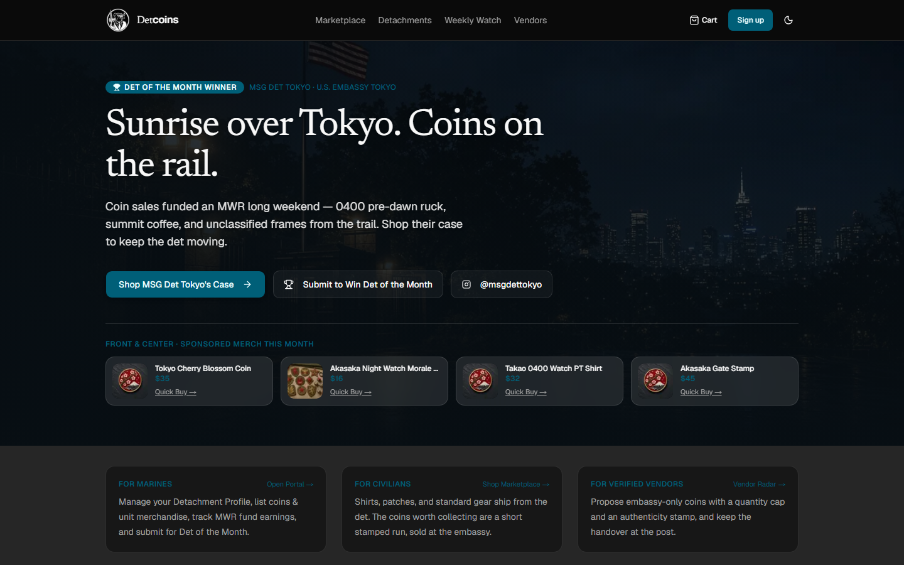

  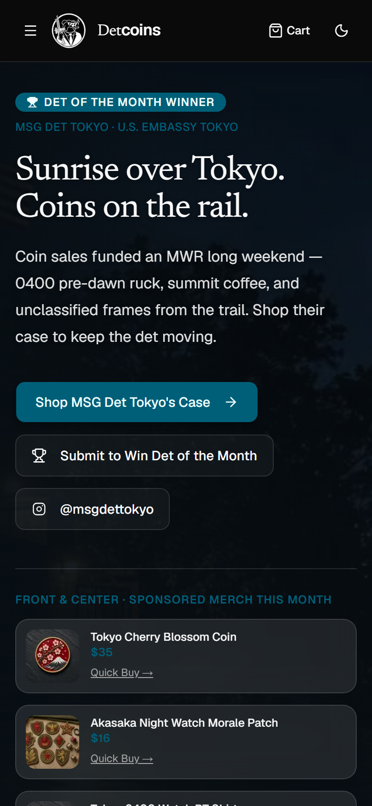

---

## Marketplace

Search by coin, post, or city. Filter to coins, PT shirts, patches, or magnets, then narrow by region and detachment.

Shirts, patches, and magnets ship. Embassy coins are a short stamped run, sold at the gate — capped, marked, and kept out of checkout. A cart can mix posts. Each detachment is paid for the items it ships, and checkout names the MWR goal.

  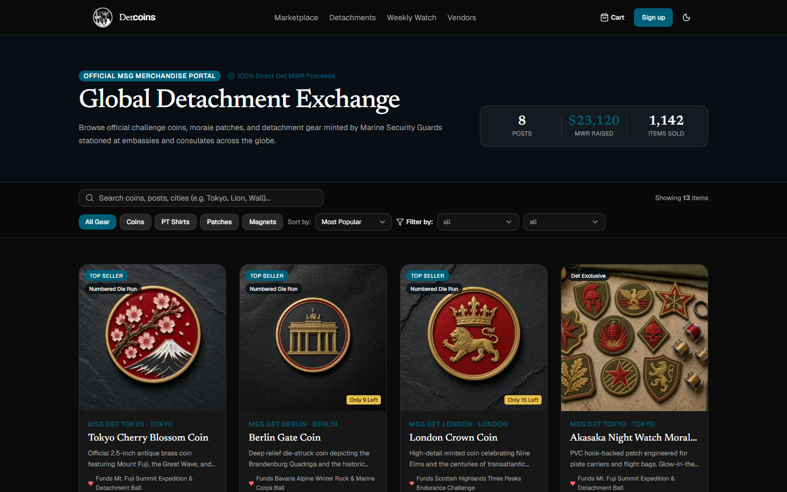

  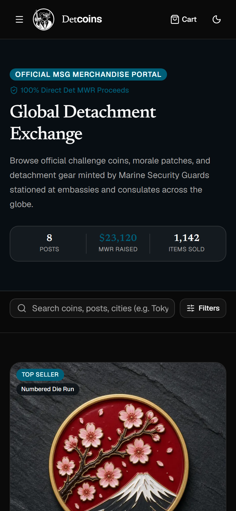

---

## Detachments

The roster is the Marine Corps Embassy Security Group, grouped by command region. Search an embassy or city, open a post, or request to join yours. Every card shows the MWR goal and how full the case is.

  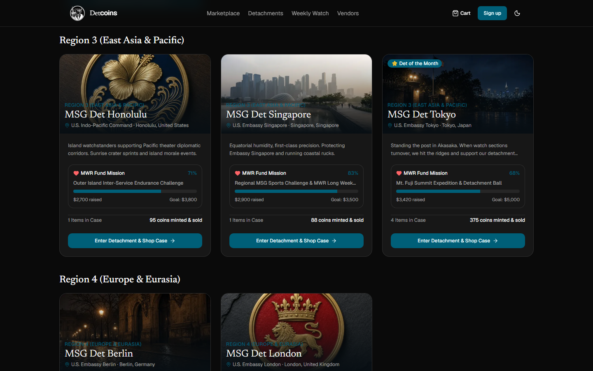

  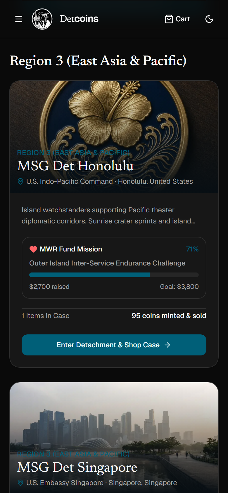

A detachment page is the public storefront: post and region, bio, Instagram, fund progress, the case, the trips those sales paid for, and Weekly Watch stories from that embassy.

  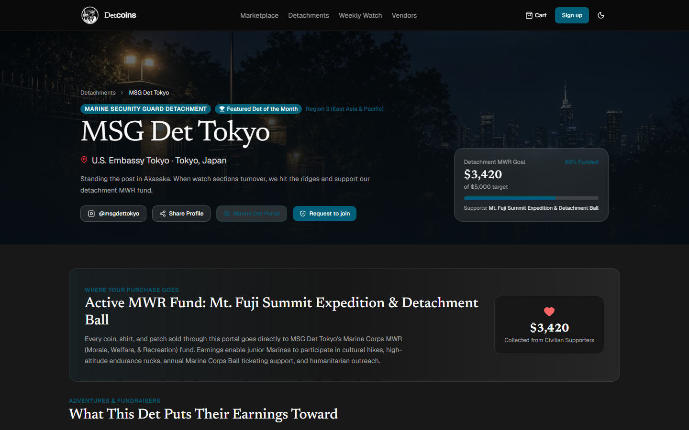

  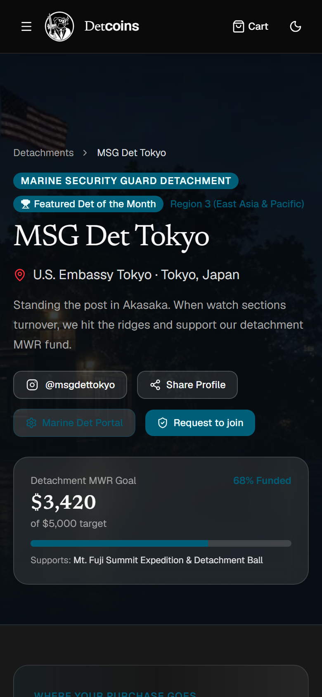

---

## Weekly Watch

Unclassified photos and stories from the watch. Readers follow the feed. Marines submit an adventure. The month’s winner takes the homepage, and their merch moves to the front of the case.

  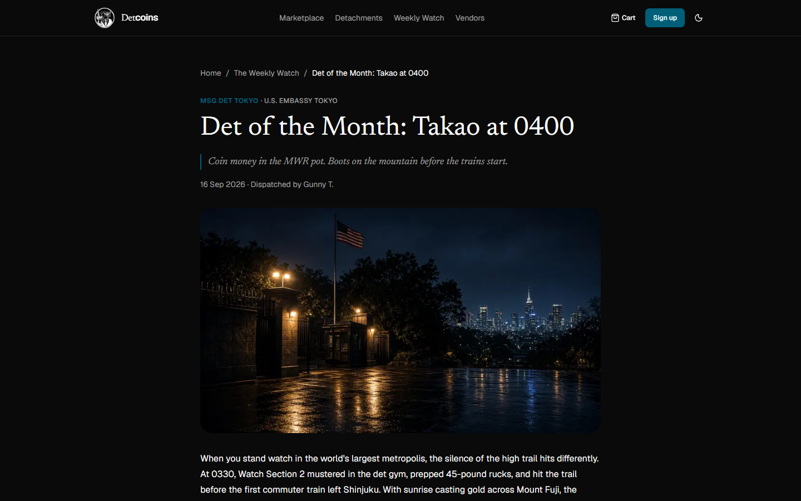

  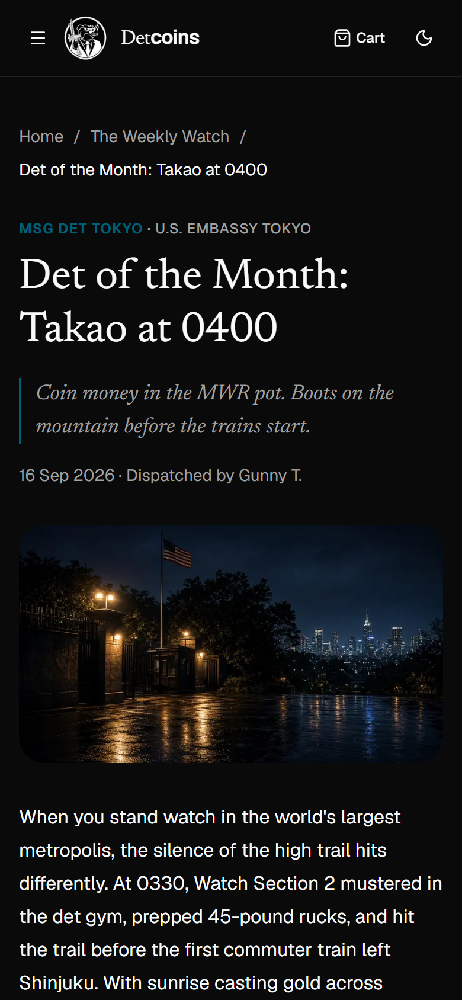

---

## Marines

The detachment portal is the control center. Switch posts, watch order alerts, and run inventory, prices, trips, and the public profile from one place. The roster and accepted vendors live here too. Submit from this screen to compete for Det of the Month.

Embassy coins show the mint cap and the stamp. Everything else can be restocked and shipped.

  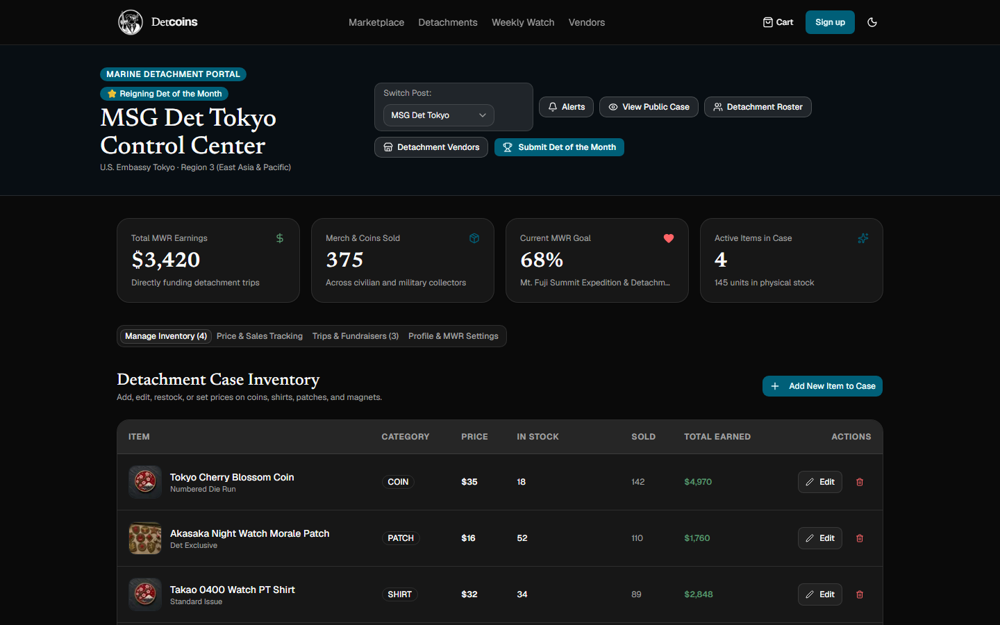

  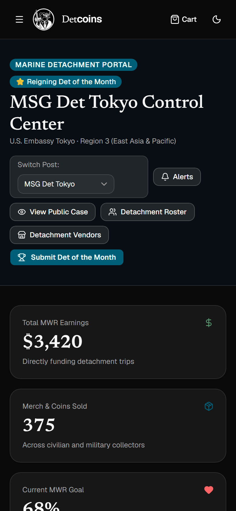

---

## Vendors

A shop applies. A site admin approves it. Each detachment then accepts that vendor before a resupply offer can go out.

Inventory radar covers accepted posts:

- **Critical** — 10 or fewer left
- **Low** — 20 or fewer

Embassy coin proposals carry a quantity cap and an authenticity stamp. The handover stays at the post.

---

<em>Stand the watch. Shop the case. Keep the det moving.</em>

Detcoins is independently owned and operated. It is not an official U.S. Marine Corps, Marine Corps Embassy Security Group, Department of State, or U.S. government website.
